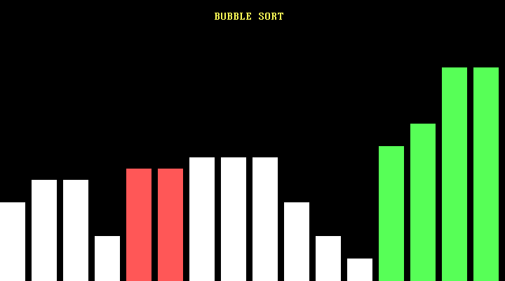
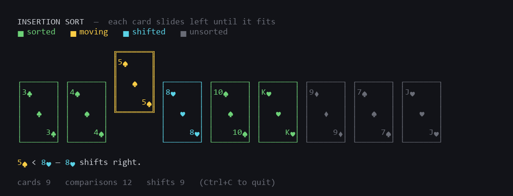

# Sorting Showcase

Four sorting algorithms, each one shown in a different place: a boot sector, your desktop, a screensaver and a terminal.

All of them sort the same kind of thing, a row of bars or cards from smallest to largest. What changes is *how* each algorithm decides what to move.

## Bubble sort: a 512-byte bootloader



**How bubble sort works:** walk along the row and compare each pair of neighbours. If the left one is bigger, swap them. After one full walk the biggest bar has "bubbled" to the end. Repeat until a walk makes no swaps.

**What you see:** the two red bars are being compared. Green bars at the right are already in place. Every swap beeps the PC speaker, and the pitch follows the height of the bar.

The whole program is 16-bit x86 assembly that fits in the 512-byte boot sector, so it runs before any operating system loads.

Needs `nasm` and `qemu` (`scoop install nasm qemu`):

```powershell
.\bootloader\run.ps1
```

To run it on real hardware, write `bubble.bin` to the first sector of a USB stick and boot in legacy BIOS mode.

## Quicksort: every bar is a real window


**How quicksort works:** pick one bar as the *pivot*. Move every bar smaller than it to the left side, then drop the pivot right after them. The pivot is now in its final spot. Do the same thing again on the left part and on the right part.

**What you see:** the yellow window is the pivot and its title bar flashes. The red window is the one being checked. Purple windows turned out smaller than the pivot. Green windows are finished. Windows hop over each other when they swap.

```powershell
cargo run --release -p quicksort-windows -- 10
```

The number is how many windows to use (2 to 30). Press **Esc** or close any window to stop.

## Merge sort: a screensaver


**How merge sort works:** split the row in half, sort each half, then merge the two sorted halves by repeatedly taking the smaller front bar of the two. The halves are sorted the same way, all the way down to single bars.

**What you see:** hundreds of rainbow bars. The part being merged right now is bright and the rest is dimmed, so you can see small sorted ramps join into bigger ones. When it's done it shows the full rainbow, shuffles, and starts again.

Try it in a window:

```powershell
cargo run --release -p mergesort-saver
```

To install it as your screensaver, run `.\mergesort-saver\make-scr.ps1`, then right-click `mergesort.scr` and choose **Install**. Any key, click or mouse move closes it.

## Insertion sort: cards in the terminal



**How insertion sort works:** like sorting a hand of cards. Take the next card and slide it left past every bigger card until it fits. Everything to its left is always sorted.

**What you see:** the yellow card is lifted out of the hand and slides left. The cyan card is the one shifting right to make room. Green cards are sorted and grey ones are still waiting.

```powershell
python python\insertion_sort.py
```

Uses only the Python standard library. Run it with `--help` for options such as hand size and speed.

## Still to come

**Selection sort** as a Create Aeronautics demo in Minecraft: an airship finds the smallest block and carries it into place, one block per pass.

## License

MIT. See [LICENSE](LICENSE).
